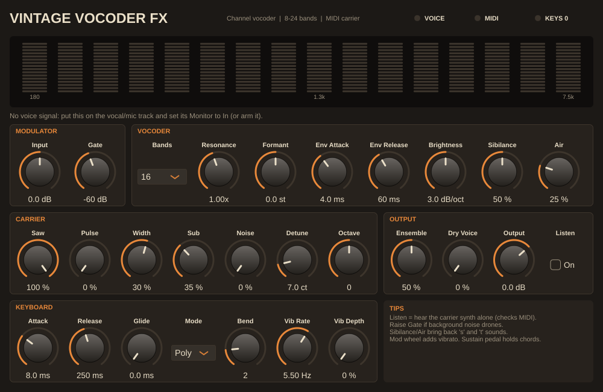

# Vintage Vocoder

A 70s-style channel vocoder plugin (VST3 / AU / Standalone) that you play with
a MIDI keyboard: sing or talk into a mic, hold chords, and the built-in carrier
synth "speaks" your words. It's modelled on the classic analog designs (Roland
VP-330, Korg VC-10, Moog/EMS, Sennheiser VSM-201).



- **8–24 band** analysis/synthesis filter banks (4th-order bands, VSM-201 spacing 180 Hz – 7.5 kHz)
- **Built-in 12-voice carrier synth**: saw (with detune), pulse/PWM, sub-octave, noise; poly or mono with legato glide, pitch bend, mod-wheel vibrato, sustain pedal
- **Unvoiced detection**: "s/t/f" sounds switch in noise, the way the hardware handled sibilants
- **Air**: the voice's own top octave mixed back in for intelligibility
- **Formant shift** ±12 semitones, **Resonance**, **Brightness** tilt, envelope attack/release, noise **Gate**
- **String ensemble** (3-phase BBD-style chorus) for the lush VP-330 sound
- Band-level meter plus VOICE / MIDI / KEYS status LEDs that tell you which routing is missing

## Two builds, because Ableton routes MIDI and sidechain differently

| Plugin | Put it on | Voice comes from | Keys come from |
|---|---|---|---|
| **Vintage Vocoder** | a MIDI track | the device's *Sidechain* chooser | the MIDI track |
| **Vintage Vocoder FX** | the vocal audio track | the track input | a MIDI track's *MIDI To* |

Full walkthrough: **[docs/ableton-setup.md](docs/ableton-setup.md)**.

Using a **Hotone Ampero II Stage** as the interface (mic into its XLR Input R,
backing tracks over USB): **[docs/ampero-ii-stage-usb.md](docs/ampero-ii-stage-usb.md)**.

## Download

Every push builds macOS (universal VST3 + AU + Standalone), Windows (VST3 +
Standalone) and Linux in GitHub Actions. Open the repository's **Actions** tab,
pick the latest green **Build** run, and download `VintageVocoder-macOS` or
`VintageVocoder-Windows` from *Artifacts*. Install steps are in
[docs/INSTALL.txt](docs/INSTALL.txt), which is also inside the zip. Pushing a
`v*` tag also publishes the zips as a GitHub Release.

## Controls

| Section | Control | What it does |
|---|---|---|
| Modulator | Input | Gain on the voice before analysis |
| | Gate | Voice level below which the bank closes (stops drones from room noise); far left = off |
| Vocoder | Bands | 8, 10, 12, 16, 20 or 24 bands: fewer = vintage/smeary, more = intelligible |
| | Resonance | Band Q multiplier: higher = narrower, more "robotic" ringing |
| | Formant | Shifts the carrier bands against the voice bands (chipmunk ↔ giant) |
| | Env Attack / Release | How fast the bands follow the voice |
| | Brightness | dB/octave tilt around 1 kHz |
| | Sibilance | Noise injected when the voice is unvoiced ("s", "t", "f") |
| | Air | Voice's own highs (> 6.5 kHz) passed through while keys sound |
| Carrier | Saw / Pulse / Width / Sub / Noise | Carrier synth oscillator mix |
| | Detune | Second detuned saw per voice (0 = single saw) |
| | Octave | Carrier transpose, -2 … +2 octaves |
| Keyboard | Attack / Release | Carrier amp envelope |
| | Glide / Mode | Portamento; Poly or Mono (last-note priority, legato) |
| | Bend / Vib Rate / Vib Depth | Pitch-bend range; vibrato (the mod wheel adds depth) |
| Output | Ensemble | String-machine chorus amount, also adds stereo width |
| | Dry Voice | Mix in the unprocessed voice |
| | Output | Output level (a soft clipper above -2 dBFS catches peaks) |
| | Listen | Hear the carrier synth alone, to check MIDI routing |

## Build from source

Requirements: CMake ≥ 3.22, a C++17 compiler (Xcode / Visual Studio 2022 / GCC ≥ 11), Git.
JUCE 8.0.9 is downloaded automatically.

```bash
cmake -S . -B build -DCMAKE_BUILD_TYPE=Release
cmake --build build --config Release --parallel
# macOS universal binary: add -DCMAKE_OSX_ARCHITECTURES="arm64;x86_64"
# Offline / local JUCE:   add -DVV_JUCE_DIR=/path/to/JUCE
```

Plugins land in `build/VintageVocoder_artefacts/Release/` and
`build/VintageVocoderFX_artefacts/Release/`.

DSP tests and the offline renderer don't need JUCE:

```bash
cmake -S . -B build-tests -DVV_BUILD_PLUGIN=OFF && cmake --build build-tests
ctest --test-dir build-tests --output-on-failure
./build-tests/vv_render demo.wav               # synthetic vowels + chord progression
./build-tests/vv_render demo.wav my_voice.wav  # vocode your own 16-bit WAV
```

## Project layout

```
Source/dsp/      JUCE-free DSP: SVF filters, envelope followers, VocoderBank,
                 CarrierSynth, Ensemble, VocoderEngine (ties them together)
Source/plugin/   JUCE wrapper: parameters, processor (buses, MIDI), editor/UI
tests/           dependency-free unit tests and synthetic test signals
tools/           offline WAV renderer
docs/            Ableton and Ampero guides, install notes
development_note/ design notes and work log
```

## Design notes and credits

The DSP is written from scratch for this project rather than forked. No
open-source vocoder offered a MIDI-played carrier plus Ableton-friendly
sidechain buses: Surge XT's vocoder is GPL-3 and tied to Surge's internals,
the mda Vocoder has no MIDI input, and small JUCE examples are demos. It does
reuse their published ideas: the Sennheiser VSM-201 band spacing and the RMS
band follower used by [Surge XT](https://github.com/surge-synthesizer/surge),
and the "hi-thru" and unvoiced noise band of Paul Kellett's mda Vocoder and the
70s hardware. See [development_note/architecture.md](development_note/architecture.md).

## Licensing

Built with [JUCE](https://juce.com) 8, which is dual-licensed under AGPLv3 and
a commercial licence. If you distribute binaries, either release this
project's source under AGPLv3 or get a JUCE licence (JUCE has a free tier
for small developers; check the current terms at juce.com). The VST3 SDK is used under Steinberg's licence
via JUCE. No licence file is included yet: choose one before publishing.
